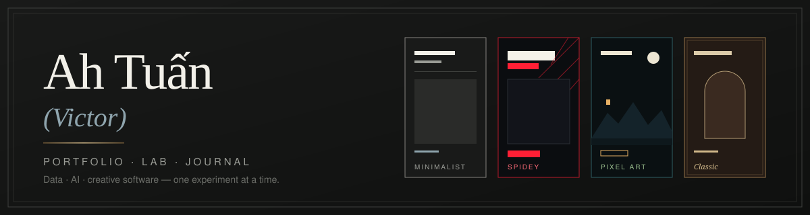
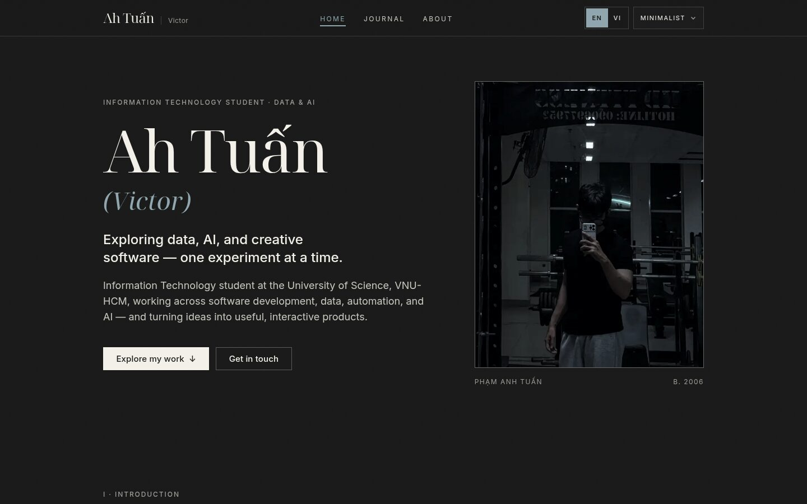
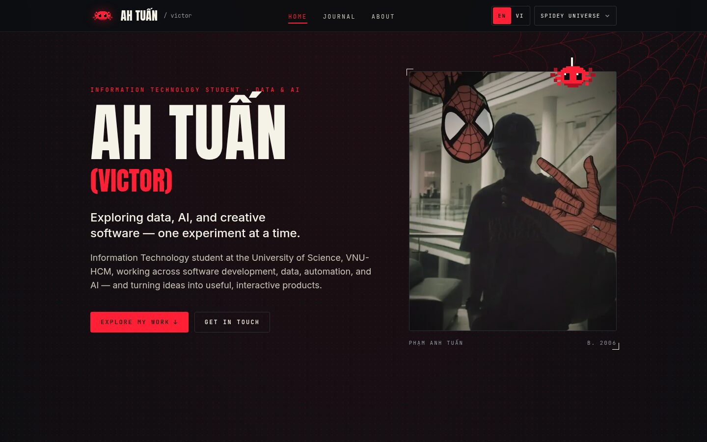
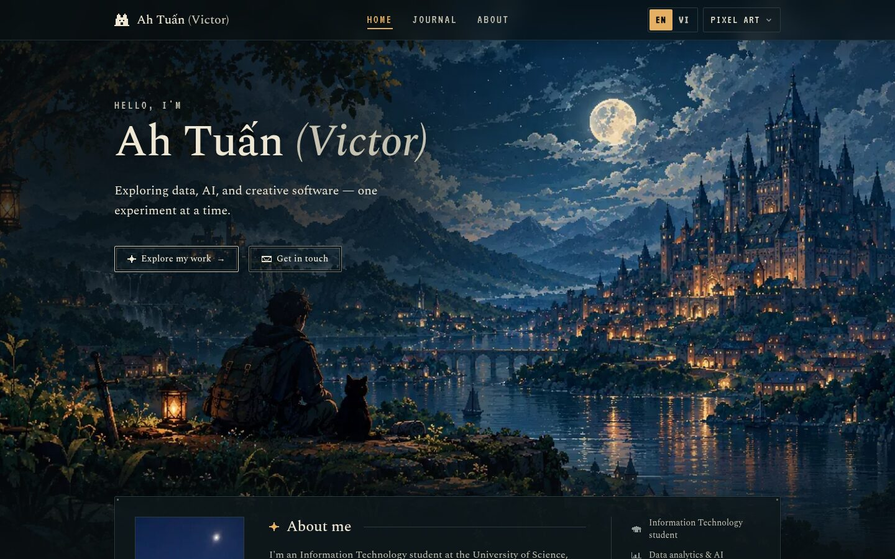
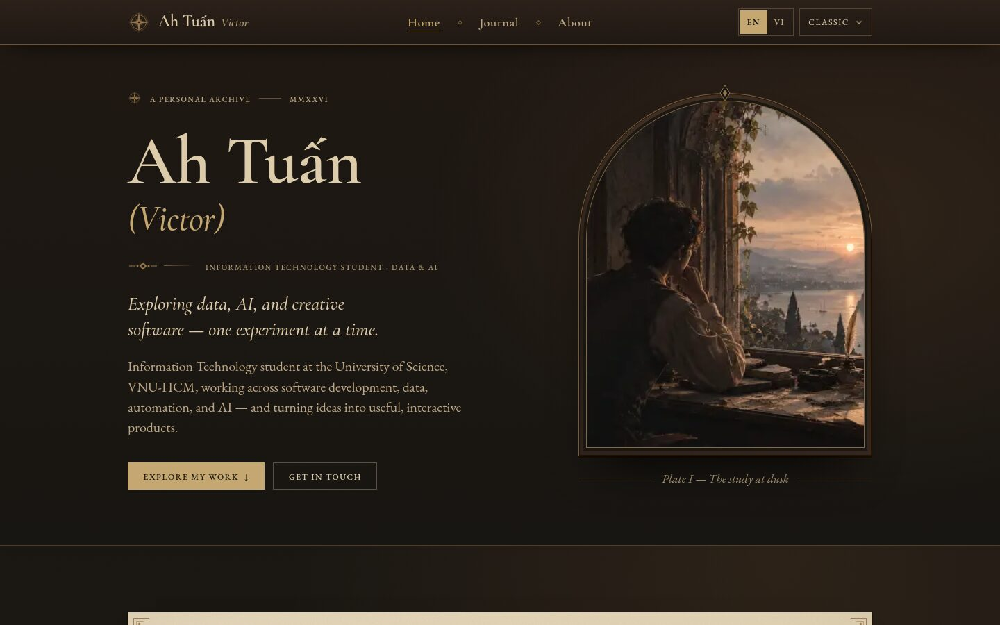
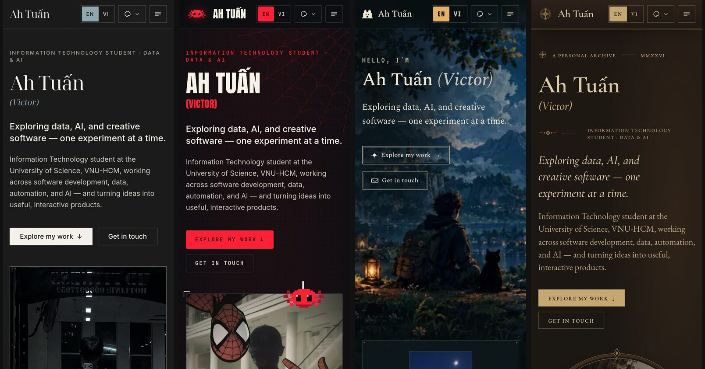
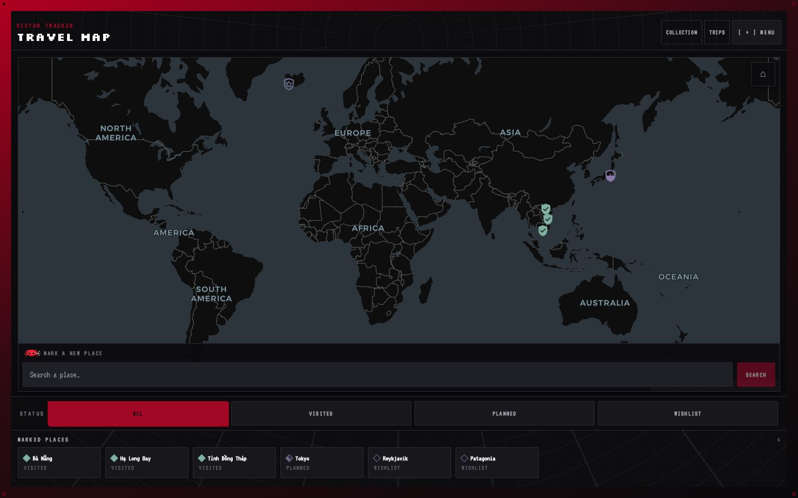
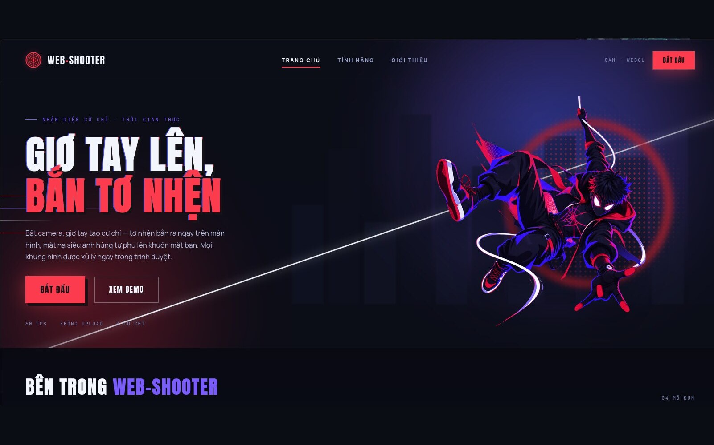
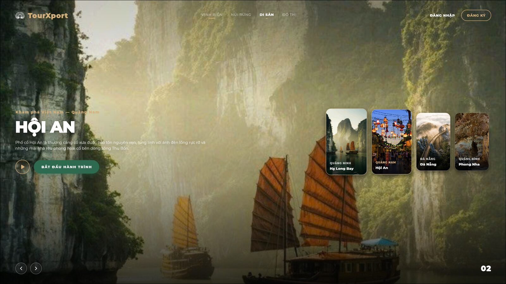

<div align="center">



<br>

[](https://github.com/ahtuan171/Portfolio/actions/workflows/ci.yml)


**Trang cá nhân song ngữ (EN / VI) của Phạm Anh Tuấn — _Ah Tuấn (Victor)_**
<br>
sinh viên Công nghệ Thông tin, ĐH Khoa học Tự nhiên – ĐHQG-HCM, đang hướng tới Data Analytics.

[Dự án](#-dự-án-nổi-bật) · [Chạy thử](#-chạy-thử-trên-localhost) · [Cập nhật nội dung](#-cập-nhật-nội-dung)

</div>

---

## ✦ Giới thiệu

Một trang portfolio, lab và nhật ký **một nội dung — bốn thế giới**. Cùng một bộ nội dung, route
và tương tác, nhưng mỗi "thế giới" có bảng màu, phông chữ, bố cục, hình ảnh và cả câu trích dẫn
riêng, thể hiện những mặt khác nhau của người làm ra nó. Chọn thế giới và ngôn ngữ ở thanh trên
cùng; lựa chọn được lưu bằng cookie nên máy chủ render đúng giao diện ngay từ đầu, không nháy.

| Trang | Nội dung |
|---|---|
| `/` | Giới thiệu → Dự án chọn lọc → Hành trình & cột mốc → Liên hệ + hoạt động GitHub |
| `/projects/<slug>` | Case study từng dự án (vấn đề, đóng góp, kiến trúc, kết quả) |
| `/journal` | Nhật ký / blog viết bằng Markdown, có RSS |
| `/about` | Câu chuyện đầy đủ: định hướng, học vấn, đang làm gì, giá trị, sở thích |

## ✦ Bốn thế giới

<table>
  <tr>
    <td width="50%" align="center">
      <br>
      <b>Minimalist</b><br>
      <sub>Editorial tối giản, chất Khắc kỷ: mực đen, ivory, đá, một màu slate.</sub><br>
      <sub><i>“Some things are in our control and others not.” — Epictetus</i></sub>
    </td>
    <td width="50%" align="center">
      <br>
      <b>Spidey Universe</b> <sub>(mặc định)</sub><br>
      <sub>Đen – kem – đỏ <code>#FF1F35</code>, mạng nhện, halftone, mascot pixel.</sub><br>
      <sub><i>“With great power comes great responsibility.” — Spider-Man</i></sub>
    </td>
  </tr>
  <tr>
    <td width="50%" align="center">
      <br>
      <b>Pixel Art</b><br>
      <sub>Khu rừng lúc chạng vạng do chính chủ vẽ, panel tối, biểu tượng pixel.</sub><br>
      <sub><i>“Not all those who wander are lost.” — J.R.R. Tolkien</i></sub>
    </td>
    <td width="50%" align="center">
      <br>
      <b>Classic</b><br>
      <sub>Dark academia: nâu óc chó, giấy da, đồng thau, chữ Cormorant Garamond.</sub><br>
      <sub><i>“…all the universe conspires in helping you to achieve it.” — Paulo Coelho</i></sub>
    </td>
  </tr>
</table>

<details>
<summary><b>Trên điện thoại</b> — bốn thế giới, cùng một bố cục một cột</summary>
<br>
<p align="center"></p>
</details>

Chuyển thế giới có hiệu ứng **corner-reveal** (View Transitions): trang mới "nở" từ một góc theo
màu của thế giới đích; tắt hoàn toàn khi người dùng chọn `prefers-reduced-motion`.

## ✦ Dự án nổi bật

<table>
  <tr>
    <td width="33%" valign="top">
      <a href="https://github.com/ahtuan171/Victor-Tracker"></a>
      <h4>Victor Tracker</h4>
      <sub>Bản đồ ký ức du lịch riêng tư kèm AI console trả lời từ chính dữ liệu của bạn.</sub><br><br>
      <sub><code>Next.js</code> <code>TypeScript</code> <code>FastAPI</code> <code>PostgreSQL</code> <code>MapLibre GL</code></sub><br><br>
      <a href="https://victor-tracker-at.vercel.app">Demo</a> · <a href="https://github.com/ahtuan171/Victor-Tracker">Code</a>
    </td>
    <td width="33%" valign="top">
      <a href="https://github.com/ahtuan171/Web-Shooter"></a>
      <h4>Web-Shooter</h4>
      <sub>Nhận diện cử chỉ tay thời gian thực ngay trên trình duyệt; làm tư thế bắn tơ và một sợi tơ phóng ra đúng hướng. Không có video nào được tải lên máy chủ.</sub><br><br>
      <sub><code>React</code> <code>Vite</code> <code>MediaPipe</code> <code>WebAssembly</code> <code>Web Audio API</code></sub><br><br>
      <a href="https://web-shooter-kappa.vercel.app">Demo</a> · <a href="https://github.com/ahtuan171/Web-Shooter">Code</a>
    </td>
    <td width="33%" valign="top">
      <a href="https://github.com/quocnam612/TourXport"></a>
      <h4>TourXport</h4>
      <sub>Ứng dụng đa nền tảng lên lịch trình du lịch Việt Nam bằng AI. Dự án môn học — mình là trưởng nhóm.</sub><br><br>
      <sub><code>Flutter</code> <code>Node.js</code> <code>FastAPI</code> <code>MongoDB</code> <code>OpenAI API</code></sub><br><br>
      <a href="https://tourxport.vercel.app">Demo</a> · <a href="https://github.com/quocnam612/TourXport">Code</a>
    </td>
  </tr>
</table>

> Số liệu, ảnh chụp và kết quả trong từng case study đều lấy từ README/thực tế của dự án — không
> có giải thưởng hay chỉ số nào được thêm vào cho đẹp. Chi tiết: [`content/projects.ts`](content/projects.ts).
> Repo của TourXport nằm dưới tài khoản của một thành viên trong nhóm.

## ✦ Điểm nổi bật về kỹ thuật

- **Song ngữ thật sự** — tiếng Anh mặc định, tiếng Việt đầy đủ; từ điển giao diện có kiểu
  (`Dictionary`) nên thiếu khoá sẽ lỗi lúc typecheck; nội dung dạng `{ en, vi }` và rơi về tiếng Anh.
- **Render theo yêu cầu, không nháy** — đọc cookie `theme`/`locale` ở server; không có script
  chống nháy phía client.
- **Một nguồn sự thật cho thế giới** — màu là bộ token `r g b` theo `[data-theme]`; component chỉ
  rẽ nhánh markup khi thế giới thật sự cần cấu trúc khác ([`lib/theme.ts`](lib/theme.ts),
  [`lib/themeArt.ts`](lib/themeArt.ts), [`components/ThemeArt.tsx`](components/ThemeArt.tsx)).
- **Nhật ký bằng Markdown** — `marked` + `gray-matter`; bản dịch `<slug>.vi.md`, bản nháp chỉ hiện
  ở `npm run dev`, mục lục, bài liên quan, RSS và sitemap.
- **Hoạt động GitHub** — biểu đồ 30 ngày + chuỗi ngày liên tiếp; có token thì dùng GraphQL, không
  có thì đọc lịch đóng góp công khai (xem [bên dưới](#widget-hoạt-động-github)).
  Ngoài ra có SVG nhúng được ở `/api/pet` và `/api/activity`.
- **Ảnh xem trước** — OG image sinh bằng `next/og`, có cả tiếng Việt có dấu.
- **Trợ năng** — một `<h1>` mỗi trang, focus nhìn thấy được, menu đóng bằng Escape, `lang` cho
  chữ khác ngôn ngữ trang, mọi chuyển động nằm sau `prefers-reduced-motion: no-preference`.
- **Không phụ thuộc thừa** — ngoài Next/React chỉ có `marked` và `gray-matter`; không UI library,
  không i18n library, không CMS.

## ✦ Cấu trúc thư mục

```text
app/                 route (App Router): /, /about, /journal, /projects/[slug], api, OG, sitemap
components/          Hero, ProjectCard, JourneyTimeline, ThemeSwitcher, ThemeQuote, …
content/             nội dung: profile, projects, milestones, about, quotes, journal/*.md
lib/                 i18n, theme, journal, github/activity, og, …
public/              ảnh chân dung theo thế giới, ảnh dự án, tranh nền Pixel Art / Classic
docs/                banner và ảnh minh họa dùng trong README
CLAUDE.md            tài liệu thiết kế và quy ước đầy đủ
CONTENT-TODO.md      những nội dung còn thiếu / cần rà lại
```

## ✦ Chạy thử trên localhost

**Yêu cầu:** Node.js 20+ (khuyến nghị bản LTS mới nhất).

```bash
npm install
npm run dev
```

Mở **<http://localhost:3000>**. Dev server tự reload khi sửa code; dừng bằng `Ctrl+C`.
`npm run dev` còn hiện bản nháp và các mục "placeholder" (đánh dấu rõ là chỉ dành cho dev).

Xem bản build production — sát với bản sẽ deploy:

```bash
npm run build
npm run start
```

```bash
npm run lint   # = eslint .  (next lint đã bị bỏ từ Next 16)
```

### Widget hoạt động GitHub

Hoạt động ngay, **không cần cấu hình gì**: khi không có token, trang đọc lịch đóng góp công khai
của tài khoản (cache 1 giờ). Đó là markup không chính thức của GitHub nên nếu GitHub đổi, widget
sẽ lặng lẽ hiện "Activity currently unavailable" chứ không báo lỗi thô.

Muốn dùng API chính thức (ổn định hơn), tạo
[classic token](https://github.com/settings/tokens) với scope `read:user` và đặt vào `.env.local`:

```bash
GITHUB_TOKEN=your_token_here
GITHUB_USERNAME=ahtuan171   # tuỳ chọn
```

Xem riêng SVG của widget tại <http://localhost:3000/api/pet>.

## ✦ Cập nhật nội dung

Nội dung nằm trong `content/`, không nằm trong component. Văn bản viết dạng
`{ en: "…", vi: "…" }` (thiếu `vi` thì hiện tiếng Anh):

| File | Dùng cho |
|---|---|
| [`content/profile.ts`](content/profile.ts) | tên, vai trò, email, mạng xã hội, trạng thái thực tập, link CV |
| [`content/projects.ts`](content/projects.ts) | dự án + case study (`showOnHome`, `draft: true` để ẩn); có mẫu cho dự án mới ở cuối file |
| [`content/milestones.ts`](content/milestones.ts) | Hành trình & cột mốc. `outcome.kind`: `award` / `participated` / `ongoing` / `completed` / `shipped` — tham gia không bao giờ được ghi thành "đạt giải" |
| [`content/about.ts`](content/about.ts) | trang `/about` |
| [`content/quotes.ts`](content/quotes.ts) | câu trích dẫn của từng thế giới (giữ nguyên văn tiếng Anh, ghi đúng tác giả) |
| [`lib/i18n/dictionaries/`](lib/i18n/dictionaries) | chữ trên giao diện: nút, nhãn, thông báo |
| `content/journal/*.md` | bài viết; copy `_template.md` để viết bài mới, bản Việt đặt tên `<slug>.vi.md` |

Những nội dung còn thiếu hoặc cần rà lại: xem [CONTENT-TODO.md](CONTENT-TODO.md).

## ✦ Triển khai

Repo chạy CI (`eslint` + `next build`) cho mỗi push và pull request vào `main`
([`.github/workflows/ci.yml`](.github/workflows/ci.yml)); Vercel tự deploy nhánh `main`.
Đặt `NEXT_PUBLIC_SITE_URL` khi có tên miền riêng để canonical, sitemap và RSS dùng đúng địa chỉ.

## ✦ Tài liệu liên quan

- [`CLAUDE.md`](CLAUDE.md) — stack, hệ thống thiết kế, chi tiết từng thế giới, quy ước nội dung
  ("không bịa") và lịch sử những gì đã bỏ.
- [`CONTENT-TODO.md`](CONTENT-TODO.md) — danh sách việc nội dung còn lại.
- [`public/assets/MASCOT.md`](public/assets/MASCOT.md) — cách dùng mascot Spidey.

## ✦ Giấy phép

[MIT](LICENSE) © 2026 Ah Tuấn.

<div align="center">
<sub>Làm bằng Next.js, một ít kiên nhẫn và rất nhiều thử nghiệm — <i>one experiment at a time.</i></sub>
</div>
